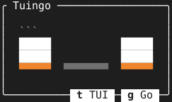

= tuingo

Terminal primitives built on https://github.com/rivo/tview[tview] and https://github.com/gdamore/tcell[tcell] for UIs that represent information in cards on lanes, and the machinery to support them: debounced watcher, self-clearing notices, actions with key legends...

Browse the link:docs/index.adoc[primitive reference], and see link:examples/board.go[examples/board.go] for a complete board with navigation and selection highlighting. Run it with `go run ./examples`.

== Install

[source,sh]
----
go get github.com/mnohe/tuingo@latest
----

Releases are tagged `vX.Y.Z` and listed under https://github.com/mnohe/tuingo/releases[Releases]. After the 1.0.0 release, pin it with `@v1.0.0`.

Requires Go 1.27.1 or later. From 1.0.0, incompatible public API changes require a new major version. See link:RELEASE_NOTES.adoc[release notes] for the supported behavior.

== Use

[source,go]
----
package main

import (
	"github.com/gdamore/tcell/v2"
	"github.com/rivo/tview"

	"github.com/mnohe/tuingo"
)

func main() {
	tuingo.RoundedTheme()
	app := tview.NewApplication()

	title, body := tuingo.CardStyles("#3b82f6", "#ffffff", "#e5e7eb", true)

	pane := tuingo.NewCardPane("board")
	pane.DrawCard("a", 0, 0, 24, tuingo.Card{
		Label: "A", Glyph: "●", Text: "first card",
		Title: title, Body: body,
	}, "")
	pane.Select("a")

	footer := tuingo.NewFooter()
	footer.Set("←↑↓→", "move", "q", "quit")

	root := tview.NewFlex().SetDirection(tview.FlexRow).
		AddItem(pane, 0, 1, true).
		AddItem(footer, 1, 0, false)

	app.SetInputCapture(func(ev *tcell.EventKey) *tcell.EventKey {
		if ev.Key() == tcell.KeyRune && ev.Rune() == 'q' {
			app.Stop()
			return nil
		}
		return ev
	})

	if err := app.SetRoot(root, true).Run(); err != nil {
		panic(err)
	}
}
----

`DrawTree` lays out a tree of `Node` values as cards joined by arrows, and `Watch` calls back once per burst of file changes so a board can rebuild itself. The doc comment on each type says what it takes.

See link:CONTRIBUTING.adoc[CONTRIBUTING] for development and releases.
