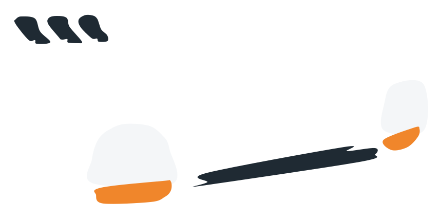

= tuingo

Terminal primitives on https://github.com/rivo/tview[tview] and https://github.com/gdamore/tcell[tcell] for screens built from cards, panes and notices. The package exists because a board of cards laid out on a plane is not a widget tview ships, and the pieces around it (a debounced watcher, a self-clearing notice, a key legend) are the same in every such screen.

What it holds:

* `CardPane`: a bordered, titled viewport over a plane of cells larger than itself, with rectangles placed on the plane that a cursor moves between. Left follows a rectangle's parent link, right its first child, up and down the nearest rectangle in that direction. `DrawCard`, `DrawTree` and `DrawLane` draw a `Card` (a label, a glyph and two lines of text), a tree of cards joined by arrows, and a column of cards; `CardStyles` and `Darker` give a card its colors.
* `TextBox`: a bordered, titled, scrolling box of text that reports the keys it offers. A key whose `Kind` is `KeyStays` (the default) sits in the legend along its bottom edge; a `KeyCloses` key sits as a chip on the bottom border, in the border's color. Chips that do not fit fold from the right into a `+ More…` chip, the first key the last to fold, and `+` opens a `KeyPanel` listing them; a folded key still runs when pressed. `Confirm`: a yes-or-no modal that also answers `y`, `n` and `esc`.
* `Watch`: a recursive fsnotify watcher that skips `.git`, adds created folders, and calls back once per burst of changes.
* `Notice`: a one-line message that clears itself after a while unless replaced.
* `Tabs` and `Footer`: a row of labels with one active and a right-aligned stamp; a key legend.
* `KeyPanel`: a bordered column of keys, one per line in the legend's style, that shows keys and handles none. `Legend` is the format, `Footer` lays it out as a row and `KeyPanel` as a column.
* `Center`: draws a primitive centered on the screen at a size computed from the screen's.
* `Wrap`, `Shorten`, `PadRight`, `Truncate`, `Width`: text helpers that count columns per rune.
* `RoundedTheme`: rounded single borders on the terminal's own background.

== Install

[source,sh]
----
go get github.com/mnohe/tuingo@latest
----

Releases are tagged `vX.Y.Z` and listed under https://github.com/mnohe/tuingo/releases[Releases]. Pin a version with `@v0.1.0`.

== Use

[source,go]
----
import (
	"github.com/rivo/tview"

	"github.com/mnohe/tuingo"
)

func main() {
	tuingo.RoundedTheme()

	title, body := tuingo.CardStyles("#3b82f6", "#ffffff", "#e5e7eb", false)

	pane := tuingo.NewCardPane("board")
	pane.DrawCard("a", 0, 0, 24, tuingo.Card{
		Label: "A", Glyph: "●", Text: "first card",
		Title: title, Body: body,
	}, "")
	pane.Select("a")

	footer := tuingo.NewFooter()
	footer.Set("←↑↓→", "move", "q", "quit")

	root := tview.NewFlex().SetDirection(tview.FlexRow).
		AddItem(pane, 0, 1, true).
		AddItem(footer, 1, 0, false)

	if err := tview.NewApplication().SetRoot(root, true).Run(); err != nil {
		panic(err)
	}
}
----

`DrawTree` lays out a tree of `Node` values as cards joined by arrows, and `Watch` calls back once per burst of file changes so a board can rebuild itself. The doc comment on each type says what it takes.

See link:CONTRIBUTING.adoc[CONTRIBUTING] for development and releases.
