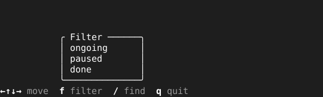

= Anchor

A dialog opened from a key in the footer reads best standing on the footer, right above that key, so the eye does not travel to find it. `Anchor` wraps a primitive so it draws there, at a size computed from the screen's on every draw, the way `Center` does for a dialog in the middle of the screen.

== How it is placed

On each draw, the wrapper asks the size function for the dialog's size, puts the dialog's bottom edge on the row above the footer and its left edge on the column at which the footer draws the key, and draws it. A dialog too wide to fit there moves left as far as it takes, and never past the screen's left edge. The column comes from `Footer.Column` on every draw, so a footer that lists different keys in different views moves the dialog with its key. When the footer does not list the key, the dialog stands at the footer's left edge.

[source,go]
----
footer.Set("←↑↓→", "move", "f", "filter", "/", "find")
pages.AddPage("filter", tuingo.Anchor(filter, footer, "f", func(sw, sh int) (int, int) {
	return 24, 6
}), true, true)
----
