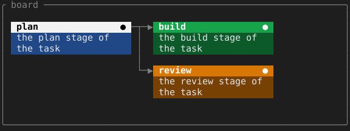

= CardPane

A board of cards laid out on a plane larger than the screen needs a viewport that scrolls and a cursor that moves between cards by their layout, and tview ships neither. `CardPane` is that viewport. This page covers how a board gets onto the pane and how the cursor moves across it.

== How a board gets onto the pane

The pane draws a plane of cells, and its owner fills the plane on every redraw. `Put` writes styled text at a plane coordinate, and `Place` declares a rectangle the cursor can land on, with the id of the rectangle an arrow leads back to. `DrawCard` does both for one card: a label and a glyph on a title row, and two lines of wrapped body text. `DrawTree` lays out a tree of `Node` values with each child one `Gap` to the right of its parent, and `DrawLane` stacks cards in a column.

The pane does not style the selection itself. The owner passes `selected` to `CardStyles` for the card under the cursor, which turns its title row near-white, so the changed function has to redraw the plane. `Clear` empties the plane and the rectangles but keeps the selection and the scroll position, so a redraw of the same content leaves the cursor where it was.

[source,go]
----
pane := tuingo.NewCardPane("board")
redraw := func() {
	pane.Clear()
	pane.DrawTree(root, 1, 1, 22, func(id string) tuingo.Card {
		title, body := tuingo.CardStyles("#3b82f6", "#ffffff", "#e5e7eb", id == pane.Selected())
		return tuingo.Card{Label: id, Glyph: "●", Text: summary[id], Title: title, Body: body}
	}, arrow)
	pane.Select(pane.Selected())
}
pane.SetChangedFunc(redraw).SetSelectedFunc(open)
redraw()
----

`Select` falls back to the first rectangle when the selected id is no longer placed, which is why the redraw ends with it.

== Which keys move the cursor

The arrow keys and the vi keys `h`, `j`, `k` and `l` move it. Left follows the selection's parent link, right goes to the first rectangle hanging off the selection, and up and down go to the nearest rectangle in that direction, preferring the same column. After a move the pane calls the changed function and scrolls the least that brings the selection into view (`Reveal`). Enter passes the selected id to the selected function.

The border and title are gray while the pane is idle and blue while it has focus; `SetFocusColors` changes both.
