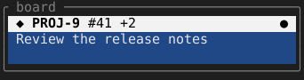

= CardTitle

A card can display a leading marker and trailing marks around its label. The label uses the card's title style. The lead and marks share its colors with bold turned off.

[source,go]
----
pane.DrawCardWithTitle("PROJ-9", x, y, w,
	tuingo.Card{Glyph: "●", Text: "Review the release notes", Title: title, Body: body},
	tuingo.CardTitle{Lead: "◆", Label: "PROJ-9", Marks: []string{"#41", "+2"}},
	parent,
)
----

The glyph stays at the right edge. The pane drops whole marks from the right to make room, then truncates the label. At very small widths the lead is clipped to the room left by the glyph.

`DrawTreeWithTitles` and `DrawLaneWithTitles` take a factory returning both a `Card` and a `CardTitle` for each ID.
