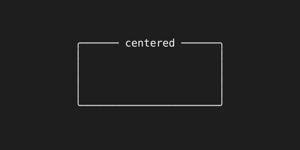

= Center

A dialog should stay centered and keep its proportions when the terminal is resized. `Center` wraps a primitive so it draws centered on the screen, at a size computed from the screen's on every draw.

== How the size is computed

The size function receives the screen's width and height and returns the primitive's, and the wrapper places the primitive in the middle before drawing it. `TextBox.Size` has that shape, so a text box centers without a function of its own.

[source,go]
----
pages.AddPage("details", tuingo.Center(box, box.Size), true, true)
pages.AddPage("help", tuingo.Center(help, func(sw, sh int) (int, int) {
	return sw / 2, sh / 2
}), true, false)
----
