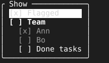

= Checklist

A set of independent switches reads best as a list of ticks that change the moment a row is chosen, with no apply step. `Checklist` is a bordered, titled list of `[ ]` and `[x]` rows.

== What a row can be

A `Row` has a key and a label. A row marked `Header` is drawn bold and owns the rows under it up to the next header, which are indented beneath it. A row marked `Muted` is drawn dim, for a row whose header is off: it still toggles, and its tick still shows.

== How a toggle arrives

`Show` lists the rows under a title, ticking those whose key is set in `checked`, with the cursor on the first row. Space calls `toggle` with the key of the row under the cursor. The dialog decides nothing about what a toggle means: the owner applies it and calls `Mark` with the rows and ticks as they now are, which redraws them and leaves the cursor where it is. Enter and esc call `close`.

[source,go]
----
show := tuingo.NewChecklist(func(key string) {
	filter.Toggle(key)
	show.Mark(filter.Rows(), filter.Checked())
}, func() { pages.RemovePage("show") })
show.Show("Show", filter.Rows(), filter.Checked())
pages.AddPage("show", tuingo.Center(show, show.Size), true, true)
----

`Size` sizes the dialog the way link:choice.adoc[`Choice`] does, counting the indent of the rows under a header.
