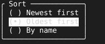

= Choice

A setting with a few exclusive values reads best as a short list with the current one marked. `Choice` is a bordered, titled radio list: each option is a `( )` row, the current one `(•)`.

== How a pick arrives

`Show` lists the options under a title, with the filled button and the cursor on the current option. The arrow keys move the cursor, and space calls `pick` with the key of the row under it. The dialog decides nothing about what a pick means: the owner applies it and calls `Mark` with the new current key, which moves the filled button and leaves the cursor where it is. Enter and esc call `close`.

[source,go]
----
sort := tuingo.NewChoice(func(key string) {
	board.SortBy(key)
	sort.Mark(key)
}, func() { pages.RemovePage("sort") })
sort.Show("Sort", []tuingo.Option{
	{Key: "new", Label: "Newest first"},
	{Key: "old", Label: "Oldest first"},
}, board.Sort())
pages.AddPage("sort", tuingo.Center(sort, sort.Size), true, true)
----

`Size` is wide enough for the title and the widest label with its button and the border, one row per option, and never larger than the screen, in the shape `Center` takes. link:checklist.adoc[`Checklist`] sizes itself the same way.
