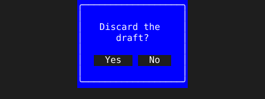

= Confirm

A yes-or-no question should answer the keys a reader reaches for without moving to the buttons. `Confirm` returns a tview modal with Yes and No buttons that also answers `y`, `n` and `esc`.

== How an answer arrives

`done` receives `true` for Yes or `y`, and `false` for No, `n` or `esc`. The modal does not remove itself, so `done` is where the owner takes it off the screen.

[source,go]
----
pages.AddPage("confirm", tuingo.Confirm("Discard the draft?", func(yes bool) {
	pages.RemovePage("confirm")
	if yes {
		discard()
	}
}), true, true)
----

The colors are tview's modal colors, so `tview.Styles` decides them.
