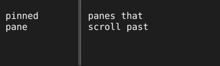

= Divider

A pinned pane beside panes that scroll past it needs an edge that reads as fixed. `Divider` draws a vertical double line down the height of its rectangle, one column wide.

== How it fits a layout

The line sits in the leftmost column of the divider's rectangle, so a one-column item in a `tview.Flex` holds it. `SetColor` sets its color; the default is the terminal's own foreground.

[source,go]
----
row := tview.NewFlex().
	AddItem(pinned, 30, 0, false).
	AddItem(tuingo.NewDivider().SetColor(tcell.ColorGray), 1, 0, false).
	AddItem(lanes, 0, 1, true)
----
