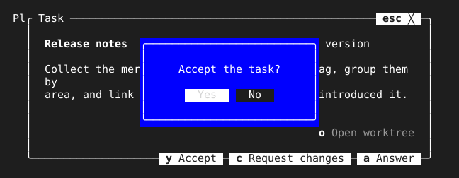

= Host

A dialog that looks modal should be modal: while it is open, no key should reach the screen under it, whatever the application's own code does with focus. tview leaves that to each application, because `Application.SetFocus` moves focus anywhere and `Pages` hands each key to the page holding focus, so a reload that focuses a box under a dialog leaves the dialog on screen with no key reaching it. `Host` makes modality a property of the toolkit.

== How it holds the keyboard

The host sits at the root, wrapping the application's screen, and the application passes it to `SetRoot`. Every key enters at the root, so while a dialog is open the host hands each key to the topmost dialog, taking focus back for it first when the application sent focus elsewhere. Mouse events outside the topmost dialog are swallowed.

[source,go]
----
app := tview.NewApplication()
host := tuingo.NewHost(app, board)
app.SetRoot(host, true)
----

== How dialogs open and close

`Open(name, p)` shows `p` over everything open so far and gives it focus, remembering the primitive that had focus. `p` draws itself where it likes, so `Center` and `Anchor` place it. `Close(name)` removes it and, when it was the topmost, sends focus back to the primitive it remembered, so the application does not track focus itself. Dialogs stack: a question asked over a details box returns focus to the details box, and closing the details box returns it to the board. Opening a name already open replaces that dialog. A dialog page the application removes itself is forgotten.

`Confirm(text, done)` opens a link:confirm.adoc[`Confirm`] through the host and closes it before calling `done`, so a question asked with it cannot be skipped past.

[source,go]
----
host.Open("details", tuingo.Center(box, box.Size))
host.Confirm("Accept the task?", func(yes bool) {
	if yes {
		accept()
	}
})
----

`Modal` reports whether a dialog is open, for an application that wants to leave focus alone while one is.
