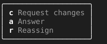

= KeyPanel

A list of keys too long for one row still has to be readable at a glance. `KeyPanel` lays the keys out as a bordered column, one key and label per line in the legend's style, and handles none of them. This page covers how it relates to the other legends and who handles its keys.

== How the panel relates to the other legends

The three share one format. `Legend` is the format, a key in bold and its label faint, returned as text; `Footer` lays it out as a row and `KeyPanel` as a column. A key reads the same in all three, so a key folded off one layout is recognisable in another.

== Who handles the keys

The screen that opens the panel. `Set` replaces the lines with key and label pairs, `Size` gives the panel's size around them, and the owner places it with `SetRect` and draws it above whatever it covers. `TextBox` opens one over its `pass:c[+ More…]` chip and keeps running every key itself, which is the pattern the panel is built for.

[source,go]
----
panel := tuingo.NewKeyPanel()
panel.Set("c", "Request changes", "a", "Answer")
w, h := panel.Size()
panel.SetRect(right-w+1, bottom-h+1, w, h)
panel.Draw(screen)
----
