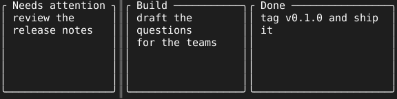

= LaneRow

A board shows its lanes side by side, and a user wants to put them in their own order and scroll through more lanes than the screen holds, with the lane they watch most kept in place. `LaneRow` lays lanes out left to right and keeps their order and scroll, whatever the lanes hold.

== How the lanes are laid out

`SetLanes` gives the lanes shown, each a `Lane` with a key, a primitive and a width. A lane of width 0 fills the columns the others leave, never fewer than the `minFill` passed to `NewLaneRow`, and lanes past the right edge are cut off there. The owner keeps deciding which lanes are shown and at what width: `SetLayFunc` tells it the row's width before each draw, so it can call `SetLanes` with the lanes that fit, and `SetFillFunc` tells it the filling lane's width. Focus goes to the filling lane, or the first when none fills, and keys go to whichever lane has focus.

[source,go]
----
row := tuingo.NewLaneRow(30, "attention", "edge")
row.SetLayFunc(func(width int) {
	row.SetLanes(
		tuingo.Lane{Key: "attention", Item: attention, Width: 32},
		tuingo.Lane{Key: "edge", Item: tuingo.NewDivider(), Width: 1},
		tuingo.Lane{Key: "plan", Item: plan, Width: 24},
		tuingo.Lane{Key: "build", Item: build},
	)
})
----

== How the lanes are ordered and scrolled

The row keeps its own order of the keys it has seen. Lanes are drawn in that order whatever order `SetLanes` gives them in, and a lane the row has not seen joins the order after the lane given before it. `Order` and `SetOrder` read and replace the order, so an owner can keep it between runs.

* `Move(key, by)` swaps a lane with its neighbour among the shown lanes, the next one for a positive `by` and the previous one for a negative `by`.
* `ScrollBy(n)` shifts the view by `n` lanes, and stops at the first lane and once the last lane is in view. The row clamps the scroll on every draw, so a wider terminal scrolls back what it no longer needs to hide.
* `Reveal(key)` scrolls the least it takes to bring a lane whole into view, after a move or when the cursor enters a lane.

The keys passed to `NewLaneRow` after `minFill` are pinned: their lanes stay leftmost in that order, never move, never scroll, and no lane moves past them. A screen pins none, one or several, and a `Divider` pinned after them marks the fixed edge.
