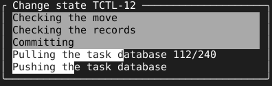

= Progress

`Progress` shows the steps started for one operation. A known total fills the bar from the left and shows the done count. A non-positive total uses a moving marker when hosted. Finished bars stay visible until the caller closes the dialog.

[source,go]
----
progress := tuingo.NewProgress(func() { host.Close("loading") })
progress.SetTitle("Load task database")
load := progress.Start("Loading tasks", 240)
index := progress.Start("Building search index", 0)
host.Open("loading", tuingo.Center(progress, progress.Size))

// Queue updates from the workers onto the UI loop.
load.Advance(112, 240)
load.Finish()
index.Finish()
----

Start all overlapping steps before finishing the last active one. The idle callback runs when the running count reaches zero. On a short screen the newest bars stay visible below an omission row.

Call dialog and process methods on the UI loop. From a background worker, use the application's `QueueUpdateDraw` to dispatch updates.
