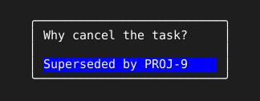

= Prompt

`Prompt` asks a question over a single-line input field. Enter submits a nonempty trimmed answer, and Escape cancels with an empty answer and `false`. The field scrolls horizontally as the reader types.

[source,go]
----
host.Prompt("Why cancel the task?", func(answer string, ok bool) {
	if ok {
		cancelTask(answer)
	}
})
----

`Host.Prompt` centers the dialog, keeps keyboard focus on it, and closes it before calling the callback. To place a standalone prompt, pass the value returned by `Prompt` and its `Size` method to `Center`, then remove it in the callback.
