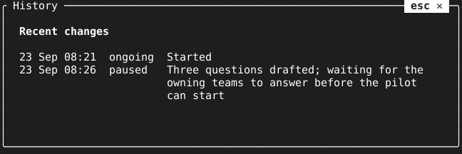

= Table

`Table` is a text block for logs and history inside a `TextBox`. Short columns
use their widest printed cell; style tags take no space and wide characters
count as terminal columns. The last column wraps under itself.

[source,go]
----
box.ShowBlocks("History", []tuingo.Block{
    tuingo.Lines{"Recent changes", ""},
    tuingo.Table{Rows: [][]string{
        {"08:21", "ongoing", "Started"},
        {"08:26", "paused", "Waiting for the owning teams to answer"},
    }},
}, nil, "")
----

The box renders blocks at its current inner width on each draw, so a resize
rewraps the table. `Show` still accepts plain lines. Missing cells are empty;
on screens too narrow for the short columns, rows wrap as ordinary text.

A grapheme wider than the available line (for example, a CJK character on a
one-column screen) is shown as `�`. Each cell starts with the default style;
a last-column style continues across its wrapped lines and resets after the row.
