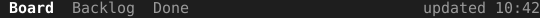

= Tabs

A screen with several views needs a row that names them and shows which one is open. `Tabs` is that row, with a stamp at its right edge for something like the time of the last update.

== How the row changes

`Set` replaces the labels and marks the one at `active` in bold and underlined; the rest are faint. `SetStamp` sets the faint text in the sixteen columns at the right edge. The row handles no keys, so the owner calls `Set` again when it switches views.

[source,go]
----
tabs := tuingo.NewTabs()
tabs.Set([]string{"Board", "Backlog", "Done"}, 0)
tabs.SetStamp("updated " + time.Now().Format("15:04"))
----
