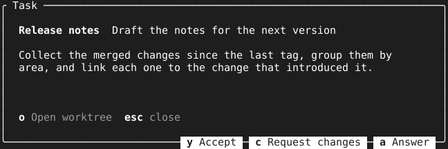
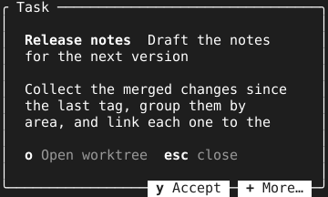
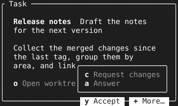

= TextBox

A details dialog offers two kinds of action: those that hand the item on and close the dialog, and those that leave it open. `TextBox` shows the difference in its layout, so the reader sees which keys end the dialog before pressing one. This page covers what the box shows, where each key goes, and what happens when the closing keys do not fit.

== What the box shows

`Show` fills the box in one call: a title in the border, lines of text with tview's color tags, the keys, and a faint note after the legend when one is given. The text scrolls on the text view's own keys, and `esc` and `q` call the close function. `Size` gives nine tenths of the screen's width up to 120 columns and 85 percent of its height, in the shape `Center` takes.

[source,go]
----
box := tuingo.NewTextBox(onKey, closeDialog)
box.Show("Task", lines, []tuingo.Key{
	{Rune: 'o', Label: "Open worktree"},
	{Rune: 'y', Label: "Accept", Kind: tuingo.KeyCloses},
	{Rune: 'c', Label: "Request changes", Kind: tuingo.KeyCloses},
}, "")
pages.AddPage("task", tuingo.Center(box, box.Size), true, true)
----

== Where each key goes

A key's `Kind` says what its action does to the box, and the box places it from that:

* `KeyStays`, the zero value, is a key whose action leaves the box open. It sits on the legend row inside the box, followed by the note and `esc close`.
* `KeyCloses` is a key whose action closes the box. It sits as a chip on the bottom border, right-aligned, with a `─` between chips and before the corner.

A chip is drawn reversed with the border color as its foreground, so it fills with whatever color `SetBorderColor` set and its ink is the terminal's background, on a dark terminal and a light one alike. The kind only decides placement: the box reports every key to `onKey`, and closing it stays with the caller. A box with no closing keys has a plain bottom border.

== What happens when the chips do not fit

The border has room for its width minus the corners and two columns of margin. When the chips need more, they fold from the right into a `pass:c[+ More…]` chip until the row fits, and the width of that chip counts too, so a chip is never swapped for one that is no narrower. The order of the keys passed to `Show` is their priority: the first key is the last to fold.

Pressing `pass:c[+]` opens a `KeyPanel` listing the folded keys, with its bottom edge on the row above the border and its right edge on the chip's. `esc` or `q` closes only the panel. When every chip is visible, `pass:c[+]` does nothing.

Folded keys stay live: pressing `c` runs it whether its chip shows or not, and closes the panel if it is open. The panel helps the reader find a key and never gates one. Two edge cases follow from the same rules:

* When even `pass:c[+ More…]` does not fit, the border shows no chips, and `pass:c[+]` still opens the panel.
* When the caller offers `pass:c[+]` as a key, the caller's key wins, so the panel cannot open, because the box checks offered keys first.
